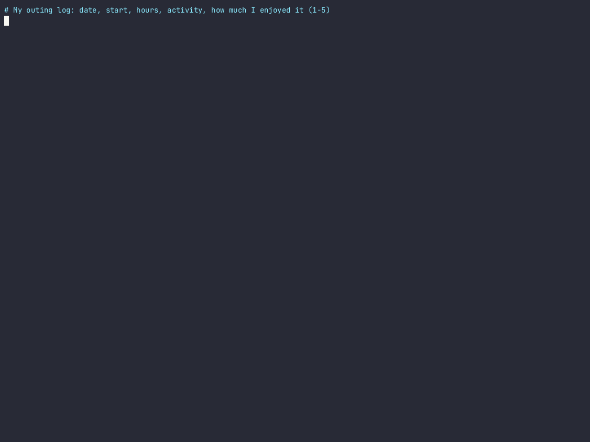

# grasscast 🌱

**When should *I* go outside this week?**

Weather apps tell you it'll be 64°F and cloudy. They can't tell you whether *you'll* enjoy a hike in that. grasscast learns that from a tiny log of your own outings, scores every daylight window in the next 7 days, and puts the best ones in your calendar. After that you can close the laptop.

- **Learns from a few dozen outings.** It uses [TabPFN](https://github.com/PriorLabs/TabPFN), an open-weight tabular foundation model that learns in context from small tables. There's no training loop and no tuning.
- **Runs locally on a CPU.** Your outing log never leaves your machine. The only network call sends your latitude and longitude to [Open-Meteo](https://open-meteo.com) (free, no API key). With a cached forecast it runs with no network at all.
- **Says when it's guessing.** Each window gets a probability and a range. If the forecast is outside anything you've logged (say you've never gone out with an 80% rain chance), the window is flagged `?` and demoted.
- **Can run unattended (optional).** The same pipeline can run as a durable [Temporal](https://temporal.io) workflow. A flaky weather API gets retried, a crashed worker resumes where it stopped, and a cron schedule refreshes the plan every morning.



> Built with PriorLabs-TabPFN · Weather data by [Open-Meteo.com](https://open-meteo.com) (CC BY 4.0)

## Quick start

```bash
git clone https://github.com/divisCorp/grasscast && cd grasscast
python -m venv .venv && source .venv/bin/activate
# CPU-only PyTorch keeps the install small; drop the index flags if you have a GPU
pip install --index-url https://download.pytorch.org/whl/cpu --extra-index-url https://pypi.org/simple -e ".[dev]"

export GRASSCAST_LAT=40.7608 GRASSCAST_LON=-111.8910 GRASSCAST_TZ=America/Denver   # where you go outside

grasscast plan --log examples/outings.sample.csv --ics plan.ics   # try it on the bundled demo log
```

The first run downloads the TabPFN v2 weights (about 100 MB, from Hugging Face, no account needed). After that, everything except the weather fetch runs offline.

## Your own log

A CSV with one row per outing. `rating` is how much you enjoyed it, from 1 to 5:

```csv
date,start,duration_h,activity,rating,notes
2026-10-04,09:00,2.5,hike,5,golden aspens
2026-10-06,17:30,1,walk,3,windy
```

Or log it in one line when you get home:

```bash
grasscast log hike 5 --hours 2.5 --notes "golden aspens"     # start time defaults to now
grasscast log run 2 --start 2026-10-06T06:30
```

You need at least 8 outings; around 20 is where it starts to know you (see [Does it work?](#does-it-work)). Each activity in your log gets its own typical duration and its own learned taste.

## Commands

| command | what it does |
|---|---|
| `grasscast plan [--activity hike] [--ics plan.ics] [--offline] [--metric]` | Best window for each of the next 7 days, plus an optional calendar file |
| `grasscast log ACTIVITY RATING [--hours H] [--start ISO]` | Append an outing to your log |
| `grasscast eval` | Cross-validated accuracy against simple baselines, on your own data |
| `grasscast durable --local` | Run the plan as a Temporal workflow on a throwaway local server |
| `grasscast durable --worker` / `--cron "0 6 * * *"` | Long-running worker plus a daily schedule (needs `temporal server start-dev`) |

## How it works

```
outings.csv ──► weather during each outing ──► feature table ──► TabPFN (in-context) ──► P(4-5★) for every
               (Open-Meteo historical-forecast      (feels-like, wind,      regressor          daylight window in
                archive, cached forever)             gusts, rain chance,                       the 7-day forecast
                                                     cloud, sun, hour, …)                             │
                                                                                                      ▼
                                                          best window per day ─► terminal  +  plan.ics
```

1. **Features.** For each outing, grasscast summarizes the hourly weather during it: feels-like temperature, humidity, rain amount and chance, cloud, sunshine, mean wind, max gust, plus start hour, weekend, and activity.
2. **Train on forecasts, not hindsight.** Past weather comes from Open-Meteo's *historical forecast* archive: what the forecast said at the time, not what actually happened. The model learns from the same kind of number it will see when it predicts.
3. **TabPFN.** `TabPFNRegressor` (v2 weights) is fitted on the log. That's in-context learning, a single forward pass, not gradient descent. It returns a full predictive distribution, and grasscast reads three things from it: the expected rating, an 80% range, and **P(rating ≥ 4)**, which is used for ranking.
4. **Candidates.** Every start hour in the 7-day forecast, for each activity, at that activity's usual duration. Windows that aren't entirely in daylight are dropped.
5. **Honesty checks.** "Why" compares each window with the conditions of your 4–5★ outings. "Untested" flags windows more extreme than anything in your log (fewer than 2 outings that rainy, windy, hot, and so on) and pushes them down the ranking.

## Does it work?

There's no real outing log to test on, so the bundled `examples/outings.sample.csv` is **synthetic**. It uses real Salt Lake City weather from April to October 2026 and a made-up person whose 1–5 ratings come from a hidden formula plus noise (see `examples/make_synthetic_log.py`). Because the true taste is known, you can check whether the model recovers it:

```
$ grasscast eval --log examples/outings.sample.csv
63 outings, activities: bike, hike, run

5-fold cross-validation, repeated twice (lower MAE is better):
                    model  MAE (stars)  rank corr
       TabPFN (grasscast)         0.59       0.87
            random forest         0.73       0.82
         ridge regression         0.89       0.76
     average per activity         1.13       0.30
always guess your average         1.31      -0.20

Held-out MAE as the log grows (how many outings until it knows you?):
model    TabPFN (grasscast)  average per activity  random forest
outings
10                     1.06                  1.27           1.15
15                     1.03                  1.30           1.11
20                     0.95                  1.29           1.07
30                     0.85                  1.21           0.90
40                     0.66                  1.16           0.78
```

TabPFN beats a random forest (sensible defaults, 300 trees) at every log size, and the gap is largest when the log is small. Small logs are exactly where a personal tool lives. Run `grasscast eval` on your own log to see how it does for you. (TabPFN's numbers move by a few hundredths between runs.)

**Known limitation, visible in the demo:** Salt Lake City summers are dry, so the synthetic log has just one outing with a rain chance above 40%. The model has never seen you in the rain, and it doesn't penalize rainy forecasts as much as it should. That's why the `untested` flag exists: those windows show up as `GO?` and are ranked below windows the model has evidence for. Log a couple of drizzly walks and that changes.

## Durable mode (Temporal)

The useful version of this tool runs by itself every morning. Over a week of mornings, a free weather API will time out at some point and a laptop will go to sleep mid-run. The pipeline is split into four Temporal activities: `build_taste_table` → `get_forecast` → `score_windows` → `write_plan`.

- Weather calls retry with exponential backoff (capped at 2 minutes) for up to 30 minutes.
- Completed steps are recorded in the workflow history. If the worker dies, a new worker continues from the next step and doesn't re-fetch anything.
- `--cron "0 6 * * *"` refreshes `grasscast-plan.ics` every morning.

```bash
GRASSCAST_CHAOS=0.6 grasscast durable --local    # makes ~60% of weather calls fail; watch Temporal retry them
TEMPORAL=temporal ./demo/crash_resume.sh         # SIGKILLs a worker mid-TabPFN and resumes on a new one
```

Real output of both runs is in [`demo/durable-chaos.txt`](demo/durable-chaos.txt) and [`demo/crash-resume.txt`](demo/crash-resume.txt). `--local` uses the open-source Temporal dev server (downloaded automatically by the Python SDK). No account and no cloud.

## Tests

```bash
pytest -q          # 17 tests: features, planner, weather cache/offline, TabPFN model, end-to-end, Temporal workflow
```

The tests never hit the network: Open-Meteo is faked. The model test uses the real TabPFN weights, and the durable test runs a real local Temporal server with injected network failures.

## Files

```
grasscast/   weather.py (Open-Meteo + cache) · features.py · model.py (TabPFN) · planner.py · pipeline.py
             evaluate.py · durable.py (Temporal) · cli.py
examples/    outings.sample.csv (SYNTHETIC) · make_synthetic_log.py
demo/        demo.gif / demo.cast / demo.mp4 · plan.txt · plan.ics · eval.txt · offline-run.txt
             durable-chaos.txt · crash-resume.txt · crash_resume.sh · record_demo.sh · test-output.txt
```

## Licenses and credits

- grasscast code: **MIT** (see `LICENSE`).
- **Built with PriorLabs-TabPFN.** The TabPFN v2 weights are downloaded at runtime from Hugging Face under the [Prior Labs License 1.1](https://github.com/PriorLabs/TabPFN/blob/main/LICENSE) (Apache 2.0 plus an attribution clause). They aren't redistributed in this repo.
- Weather data by [Open-Meteo.com](https://open-meteo.com), licensed CC BY 4.0.
- Temporal (MIT) for durable execution.
- Built with help from an AI coding assistant. Every line was run and tested, and the demo outputs in `demo/` are real captured output.

## Contest note

Created during the DEV Hacktoberfest Open-Source AI Challenge, Week 1 (Oct 5–11, 2026). Any commits after the submission deadline (Oct 11, 2026, 11:59 PM PDT) will be listed here.
